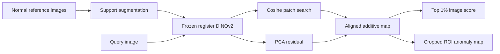

# SAFAL: Register-DINO Search with PCA Correction

Few-shot industrial image anomaly detection and localization on **MVTec AD**
and **VisA**. This repository follows the experiment-oriented organization
of [VisionAD](https://github.com/Qiqigeww/VisionAD): public model modules,
native dataset classes, simple fitting/testing scripts and dataset-specific
entry points. Existing SAFAL fitted banks remain compatible.

[Download source ZIP](https://github.com/ennayriomar/newpr/raw/refs/heads/main/safal_visionad_style_code.zip)
· [Training guide](docs/TRAINING.md)
· [Measured study](https://github.com/ennayriomar/newpr/blob/0d0b1db6c0133d3876bd18cc9920f930dfeb2519/results/vision_hybrid_20261015/report.md)
· [Previous model download](https://github.com/ennayriomar/newpr/raw/0d0b1db6c0133d3876bd18cc9920f930dfeb2519/vision_hybrid_20261015.zip)

## 1. Method

The frozen DINOv2 ViT-L/14 register encoder averages raw blocks 4–18. Normal
references receive six support augmentations in three scoring slots. The
search branch uses exact cosine patch matching; the PCA branch adds a
normalized residual. The source-selected preset uses one global PCA,
95% retained variance, strength 0.5 and a uniform gate. Its operational
cutoff comes from separate source-category normal images.



Target-bank fitting uses only normal references. The preset selection used
50 normal and 50 anomalous source-category development images plus masks.
This independent research hybrid is not a claimed new state of the art or a
reproduction of the full VisionAD benchmark.

## 2. Repository structure

```text
models/
  uad.py                  # SAFAL search + PCA model
  vit_encoder.py          # Frozen register-DINO encoder
dataset.py                # Native MVTec AD / VisA Dataset classes
utils.py                  # Paths, frozen configuration and integrity checks
train.py                  # Fit one category's normal-reference bank
test.py                   # Evaluate search baseline and hybrid
predict.py                # Predict a single image
hybrid_mvtec_test.py       # MVTec AD evaluation entry point
hybrid_visa_test.py        # VisA evaluation entry point
train_study.py            # Reproduce source selection and reserved study
prepare.py                # Fetch verified official encoder assets
prepare_data/             # Native dataset-layout instructions
configs/                  # Encoder settings and frozen source-selection files
tests/                    # New dataset / interface contract tests
framework/                # Shared numerical implementation and legacy tests
docs/                     # Training, compatibility and archived documentation
```

Historical reports, ZIPs, archive parts and fitted banks retain their existing
paths. They are excluded from the lightweight source ZIP.

## 3. Environment

Extract the **source ZIP**, or use a source-only Git checkout:

```bash
git clone --filter=blob:none --no-checkout https://github.com/ennayriomar/newpr.git SAFAL
cd SAFAL
git sparse-checkout set --no-cone '/*.py' '/*.sh' '/README.md' '/requirements.txt' '/.gitignore' '/models/' '/configs/' '/tests/' '/docs/' '/prepare_data/' '/framework/'
git checkout main
```

Linux/WSL and Python 3.12:

```bash
bash setup_environment.sh
source .venv/bin/activate
python prepare.py --destination checkpoints
```

The default runtime is CPU. The separate official encoder weight file is
1.22 GB and checksum-verified. CUDA requires a suitable GPU Torch build and
freshly fitted banks; CPU verification does not establish GPU results.

## 4. Prepare datasets

Keep MVTec AD's original category/train/good, test and ground_truth folders.
For VisA, retain the native Data folders, image_anno.csv and split_csv/1cls.csv.
See [dataset instructions](prepare_data/README.md) for the exact layout and
original download links. Set `--data_path` to your extracted dataset root.

## 5. Train and evaluate

Training fits the normal reference memory and PCA subspaces. The foundation
encoder stays frozen; this method has no training epochs or optimizer.

MVTec AD:

```bash
python train.py --dataset mvtec_ad --data_path data/mvtec_ad \
  --category bottle --shots 1 --seed 17 --output runs/bottle
python hybrid_mvtec_test.py --run-dir runs/bottle --localization --save-maps
```

VisA:

```bash
python train.py --dataset visa --data_path data/visa \
  --category capsules --shots 1 --seed 17 --output runs/capsules
python hybrid_visa_test.py --run-dir runs/capsules --localization
```

Use a new output directory per category/draw. `test.py --run-dir runs/bottle`
is the generic evaluation command. `--max-images 2` performs an explicitly
marked smoke subset. Training saves `model.json`, `model.npz` and
`training.json`; evaluation writes metrics and per-image predictions.

Commands for reproducing development selection are in the
[training guide](docs/TRAINING.md). That known-cohort reproduction is separate
from fitting a new category bank and is not a new independent validation.

## 6. Predict

```bash
python predict.py --model runs/bottle/model --image /path/to/bottle.png \
  --output runs/my_prediction
```

Prediction accepts no labels or masks. Maps cover the center-cropped ROI;
outer borders are unscored. Scores are not calibrated probabilities.

## 7. Actual measured results

The earlier locked CPU study used 100 reserved image IDs across five
categories and two support draws: 200 correlated query/draw cases.

| Metric | Search baseline | Selected hybrid |
|---|---:|---:|
| Mean image AUROC | 97.80% | 98.70% |
| Accuracy at shared source cutoff | 78.50% | 75.50% |
| Mean cropped-ROI pixel AP | 0.4705 | 0.5020 |
| Missed anomaly cases / 100 | 43 | 1 |
| False alarms / 100 normal cases | 0 | 48 |

**The accuracy-improvement goal was not met.** The conditional AUROC difference
interval is −0.50 to +3.00 percentage points and includes zero. Additional
false alarms offset recovered anomalies at the shared cutoff. This repository
reorganization changes the interface, not those scientific results. The full
27-category/five-draw/1–2–4-shot benchmark has not been run.

[All 20 fitted banks and raw study outputs](https://github.com/ennayriomar/newpr/tree/0d0b1db6c0133d3876bd18cc9920f930dfeb2519/results/vision_hybrid_20261015_archive)
are retained separately. The archive downloader is
`framework/download_vision_hybrid_results.py`. MVTec-derived banks retain
noncommercial CC BY-NC-SA 4.0 conditions; VisA-derived banks retain CC BY 4.0.

## 8. Validation and references

```bash
python -m unittest discover -s tests -v
PYTHONPATH=framework python -m unittest discover -s framework/tests -v
```

See [layout and compatibility](docs/REPOSITORY_LAYOUT.md) for the mapping to
the reference structure. The previous root README is preserved under
`docs/archive` and in Git history. Source organization is inspired by VisionAD;
its repository code is not redistributed here.

- [VisionAD: Search is All You Need for Few-shot Anomaly Detection](https://arxiv.org/abs/2504.11895)
- [DINOv2](https://arxiv.org/abs/2304.07193)
- [MVTec AD](https://www.mvtec.com/research-teaching/datasets/mvtec-ad)
- [VisA / SPot-the-Difference](https://github.com/amazon-science/spot-diff)
