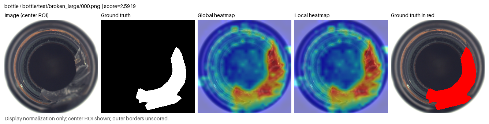
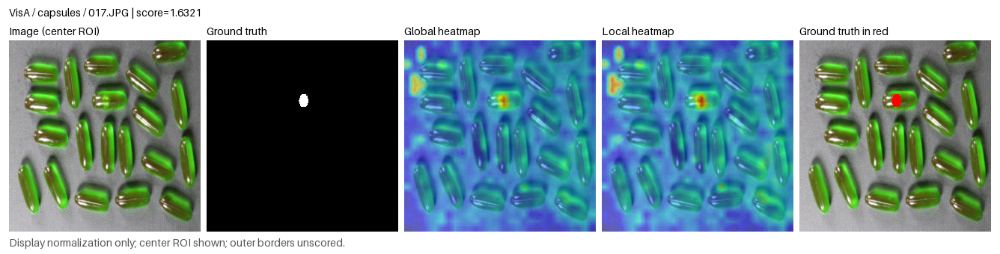

# Real output-format examples

These illustrate SAFAL's VisionAD-style presentation. Each row contains the
scored image ROI, binary ground truth, global-normalized heatmap,
image-normalized heatmap and a red ground-truth overlay. The five panels
are also available as separate PNGs in the corresponding folders.

## MVTec AD bottle

The accompanying log and tables describe a **two-image smoke subset** using
one normal support image. Its Mean row covers one category only. These small
numbers are not a full-category performance estimate or a new benchmark.

- [Console log](mvtec_bottle/result.log)
- [CSV table](mvtec_bottle/metrics.csv)
- [Markdown table](mvtec_bottle/metrics.md)

## VisA capsules

This image is the first anomalous query in the existing locked capsules
verification sequence for draw 17. It reuses the previously computed raw map;
there was no new training, parameter selection or accuracy experiment.
Global display normalization uses that existing 20-image category/draw cohort.

## Attribution and derived-image licenses

MVTec AD images are credited to MVTec Software GmbH and Bergmann et al.,
*MVTec AD* (CVPR 2019). The cropped bottle image, mask and derived visualizations
retain **CC BY-NC-SA 4.0**, including its noncommercial and share-alike terms.
[Dataset](https://www.mvtec.com/research-teaching/datasets/mvtec-ad) ·
[License](https://creativecommons.org/licenses/by-nc-sa/4.0/)

VisA images are credited to the VisA creators and Zou et al.,
*SPot-the-Difference* (ECCV 2022). The cropped capsules image, mask and derived
visualizations retain **CC BY 4.0**.
[Dataset](https://github.com/amazon-science/spot-diff) ·
[License](https://creativecommons.org/licenses/by/4.0/)

Modifications comprise center cropping, resizing, predicted-map color overlays,
red ground-truth overlays and panel labels. Global/local scaling is for
display only; raw maps and operating thresholds are unchanged. Original
image IDs and SHA256 provenance are recorded in [METADATA.json](METADATA.json).
