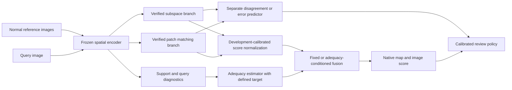

# SAFAL implementation plan after Phase A

Project: **Support-Adequacy-Aware Few-Shot Anomaly Localization for Reliable Industrial Inspection**.

Current authorized scope is **Phase A only**. This document plans later work;
it does not claim that the phases below have been completed or start new runs.
The existing `safe_iad` package and published v0.4.0 artifacts remain intact.
The working research method name is SAFAL; no package rename is required to
establish the research foundation.

## Foundation established

- The research repository is `ennayriomar/newpr`. The profile repository
  `ennayriomar/ennayriomar` is preserved separately.
- Official SubspaceAD and the research-method VisionAD have been identified,
  with pinned source revisions and explicit recipe differences recorded in
  [literature_review.md](literature_review.md).
- Current data inventory has 20,089 images across MVTec AD, VisA and retained
  MVTec AD 2. Real-IAD is absent; see [dataset_readiness.md](dataset_readiness.md).
- CPU inference with actual pretrained DINOv2 ViT-B/14 is established by prior
  verified runs. A faithful giant/registers SubspaceAD or large/registers
  VisionAD benchmark is not established.
- Existing unit/contract tests and preliminary experiments are evidence of
  their declared scopes, not evidence that SAFAL improves accuracy.

## Phase B: establish reference branches

1. Specify two separate tracks: the exact published baseline recipes and a
   paired common-backbone comparison. Give every modified recipe a distinct
   label; do not transfer published scores into our tables.
2. Resolve VisionAD source redistribution terms before vendoring or adapting
   its implementation. Its mathematics can be independently implemented with
   attribution, but that alone does not establish source-level fidelity.
3. Pin the recipe and checkpoint for each track. Reproduce support selection,
   original-image budgets, augmented views, layers, register-token removal,
   input geometry, scoring, map postprocessing and image aggregation.
4. Wrap prediction export with independently verified metrics. The inspected
   VisionAD visualization evaluator returns placeholder numerical metrics;
   it must not be used as evidence of accuracy.
5. Verify each branch on a small controlled dataset subset with real images,
   masks and pretrained weights. Compare raw scores against the reference
   scorer under identical settings before interpreting benchmark metrics.
6. Record wall-clock, cache status, support preparation, peak memory and native
   map storage. Assess CPU feasibility separately from a GPU reproduction.

Exit evidence: source/checkpoint provenance, exact commands/configs, branch
parity checks, spatial alignment checks, explicit deviations, and a verified
small baseline experiment. k=8 is a declared extension where the inspected
reference script only benchmarks k=1,2,4.

## Phase C: define and implement the hypothesis

1. Define the event or measurable criterion that `A(S,q)` is intended to
   predict. Distinguish normal-mode coverage, intervention benefit and
   prediction correctness; they are different targets.
2. Separate support-only descriptors from query-conditioned diagnostics.
   Candidate diagnostics include normal-mode coverage, nearest-reference
   density, subspace stability and leave-image-out sensitivity. k=1
   leave-image-out is missing, not zero or perfectly stable.
3. Define a bounded adequacy score and state whether it is a diagnostic, an
   estimated event probability or a calibrated error predictor. A sigmoid
   alone does not establish probability semantics.
4. Implement constituent-only, fixed-average and adequacy-conditioned fusion.
   Define score normalization and the weight function in advance. Fit learned
   parameters on declared development data with image/group separation.
5. Keep disagreement/uncertainty separate from adequacy. Add abstention only
   with a defined correctness event and an explicit calibration split.
6. Preserve both raw branches, fusion weights, adequacy diagnostics, final
   maps, image decisions and any unresolved decision evidence.

An illustrative architecture for later implementation is:

These boxes are a plan, not placeholder implementations or completed research
components. The scope of a future reliability claim depends on validation of
the adequacy/error target, not on drawing the architecture.

## Phase D: test the complete small experiment

Use normal-only support sets and shared reference IDs for all comparisons.
Verify decoding, mask alignment, cache invalidation, label-free inference,
reference/acquisition budgets and calibration isolation. Freeze configuration
and weights before evaluation. Save complete stage/input/code ledgers and test
checkpoint reuse without relabeling integrity checks as independent reruns.

Compare both branches, fixed fusion and adaptive fusion on paired query and
support draws. Measure image AUROC/AP, pixel AUROC/AP, region overlap, locked
misses and false alarms. Assess whether adequacy/uncertainty predicts actual
errors with risk–coverage and error-detection metrics. Evaluate controlled
support omissions with matched budgets and unchanged query labels.

Declare an exposure ledger: categories and images inspected in historical
pilots cannot be relabeled as pristine final holdouts. Distinguish source-only
calibration from extra target-normal calibration. If k reference images plus
four target normals set cutoffs, report the k+4 information budget; that is not
a strict k-image experiment. Augmented views and additional original images
must be counted separately.

Exit evidence: a fully audited small experiment and a prespecified feasibility
decision that includes false alarms and missed defects. Negative findings
remain in the report; a favorable average cannot hide harmful slices.

## Phases E–G: benchmarks, analysis and manuscript

Proceed only after the reference branches and Phase D contracts are verified
and resources fit the chosen scope. Obtain suitable GPU/runtime and storage
for larger official recipes or full native-map exports. Real-IAD additionally
requires verified dataset terms, access, archives and physical-part grouping.
AD 2 private scores require official-server evaluation; public previews are
separate results.

Record complete configurations, prediction files and checkpoints. Aggregate
by dataset/category/shot and support draw, keeping query-image/physical-part
dependencies in statistical resampling. Probability metrics require a defined
probability target and independent calibration. Report efficiency per method
with exact hardware, resolution, batch size and cache status.

Generate figures and tables from verified machine-readable results. Draft the
manuscript only around established evidence, with explicit negative results,
baseline deviations, calibration assumptions and limitations. Novelty and
journal acceptance remain unresolved; neither is promised by this plan.

## Decisions and prerequisites for the next phase

- Choose the faithful-reference track and the controlled-backbone track before
  interpreting any comparison as baseline reproduction.
- Resolve VisionAD's code terms and replace its nonnumerical evaluation path
  with a verified prediction/metric wrapper.
- Establish an operational adequacy target and development/calibration/final
  split policy, including prior exposure and any extra target-normal images.
- Budget storage, runtime and GPU access for the selected recipes. Current
  resources support small CPU work, not the advertised full Real-IAD releases
  or the existing terabyte-scale native-map plan.

No unanswered preference blocks Phase A. These are explicit next-phase
research decisions, not requests to approve an unfinished audit.
