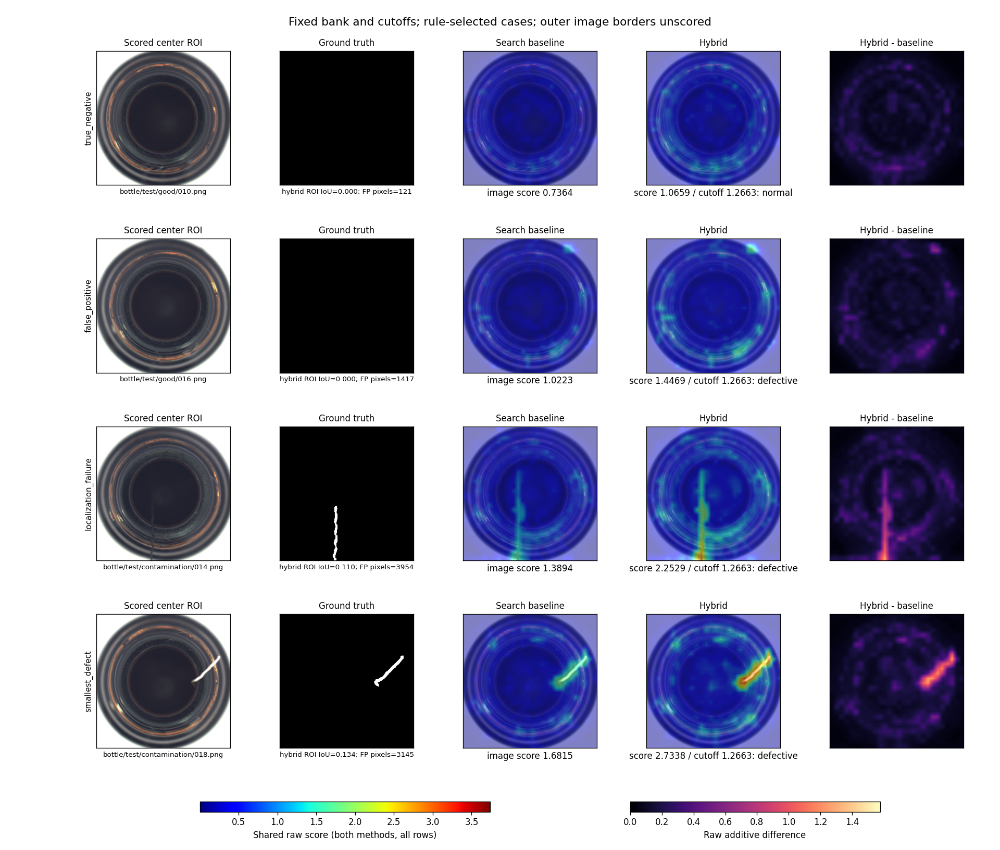

# Full bottle category audit

83 native test images: 20 normal, 63 anomalous. One normal support image, seed 17.

Global/Local in the old figure meant two display scalings of the same hybrid map. They did not compare branches.
The original large-defect figure was the first anomaly in a two-image smoke check, not a representative benchmark selection.

Image metrics use every native test label but crop-derived scores. Pixel metrics use the center 392/448 ROI only (76.56% of resized image area); outer borders are unscored.
Native GT pixels outside the crop: 15668 across 4 images (native pixel-center crop footprint).

| Method | Image AUROC (95% interval) | ROI AU-PRO (95% interval) | Accuracy at fixed cutoff | FP / normal | FN / anomaly |
|---|---|---|---|---|---|
| baseline | 0.9897 [0.9667, 1.0000] | 0.9357 [0.9080, 0.9579] | 0.8795 | 0 / 20 | 10 / 63 |
| hybrid | 0.9968 [0.9881, 1.0000] | 0.9426 [0.9203, 0.9610] | 0.9036 | 8 / 20 | 0 / 63 |

Paired hybrid-minus-baseline differences (95% conditional intervals):
- image_auroc: +0.0071 [-0.0024, +0.0270]
- au_pro: +0.0069 [+0.0022, +0.0129]

Intervals: 2,000 paired, native-label-stratified query-image bootstrap replicates, conditional on this fitted bank. They exclude support/training/category uncertainty. AU-PRO uses the original cohort's fixed 128-score-rank threshold grid, 8-connected regions and FPR limit 0.3; its interval is a sampled-grid approximation. Bootstrap arrays and sufficient statistics are saved for replay.

Baseline/hybrid maps identical: 0 / 83. See per_image.jsonl for raw max/mean absolute differences and separate display-scaling differences.

Locked image cutoff: 1.266317319869995; pixel cutoff: 1.1265572309494019. Neither was optimized on this category.

## Fixed-rule examples

Selection was recorded in protocol.json before full-category inference. Outcome-selected failure illustrations are diagnostic examples, not a random sample.

- true_negative: `bottle/test/good/010.png`
- false_positive: `bottle/test/good/016.png`
- smallest_defect: `bottle/test/contamination/018.png`
- miss: none observed at the locked cutoff
- localization_failure: `bottle/test/contamination/014.png`

## Defect coverage excluded by the crop

- `bottle/test/broken_large/003.png`: 6460 / 222091 native GT pixels outside the crop.
- `bottle/test/contamination/007.png`: 2921 / 45048 native GT pixels outside the crop.
- `bottle/test/contamination/013.png`: 5507 / 41319 native GT pixels outside the crop.
- `bottle/test/contamination/014.png`: 780 / 5429 native GT pixels outside the crop.

Each selected case has a native-ID metadata JSON and an unchanged raw NPZ beside the figure. All 83 maps, native input hashes and paired scores are in ../evaluation. Heatmaps share one raw-score scale across methods and cases; additive differences have a separate labeled scale.

These results describe the known bottle category and one fitted bank. They do not establish full-image segmentation performance, generalization across support draws, or superiority to a published full-dataset benchmark.

Dataset attribution: MVTec Software GmbH; Bergmann et al., CVPR 2019. Derived images and GT masks retain MVTec AD's CC BY-NC-SA 4.0 license. Code licensing is unchanged.
