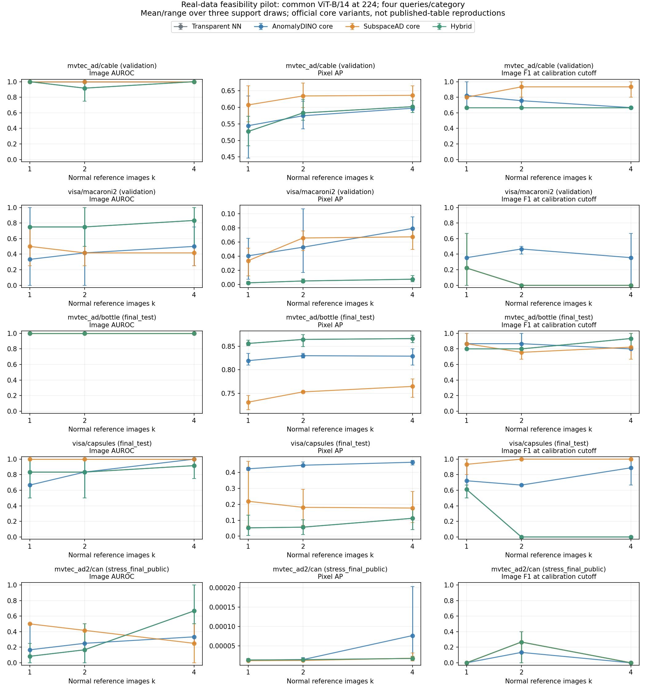

# Safe IAD results

[Read the final report](hybrid_framework_report.md) · [Download every result file](https://github.com/ennayriomar/newpr/tree/main/results_archive)

The repository contains all report text, metrics, plots, provenance, and validation records. The complete archive preserves all 4,580 original result files, including raw `.npz` anomaly maps, public AD 2 `.tiff` predictions, and archived implementation bytecode. See [RESULTS_README.md](RESULTS_README.md) for download, checksum verification, and extraction instructions.

The current strict pilot evaluated five categories and 20 unique evaluation queries, using three support draws at k=1,2,4. The full 20-category plan and private AD 2 evaluation have not been run. Hybrid accepted 165/180 repeated inspections; 88/165 accepted decisions were correct. These are correlated pilot observations.

## Current strict run

- [Metrics CSV](hybrid_pipeline_strict/metrics.csv) and [JSON](hybrid_pipeline_strict/metrics.json)
- [Summary plot](hybrid_strict_summary.png) and [PDF](hybrid_strict_summary.pdf)
- [Output validation](hybrid_strict_validation.json)
- [Reproduction precision checks](hybrid_strict_reproduction_precision.json)
- [Split manifest](hybrid_pipeline_strict/split_manifest.json)
- [Source provenance](hybrid_pipeline_strict/source_provenance.json)
- [Artifact ledger](hybrid_pipeline_strict/artifact_ledger.json)
- [SHA256 manifest of every original result file](RESULTS_MANIFEST.json)

## Preserved experiment history

`hybrid_pipeline` uses the superseded exploratory calibration protocol; `hybrid_pipeline_preprocessing_audit_attempt` is interrupted. `baseline_pilot` and `milestone2` preserve earlier experiments. Each retains its recorded provenance. The original reports' absolute `/workspace` paths describe the cloud execution environment; the files are now distributed in this repository and its release.
