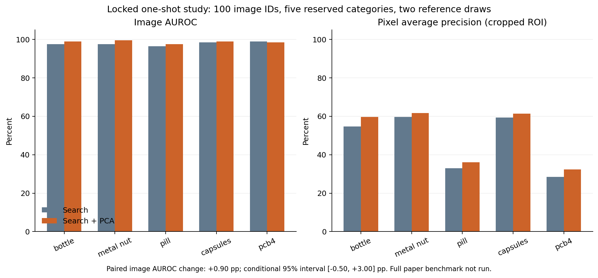

# Register-DINO search with the selected global PCA correction

Bounded one-shot paired study; new verification image IDs and categories held out from this study parameter selection; some categories may have earlier prototype exposure. Not the full paper benchmark.

This is a strict one-target-image support budget, with zero extra target calibration images. Development selection uses 100 images in five other categories; verification uses 100 available-history-excluded image IDs in five categories and two support draws (200 paired cases).

## Locked candidate

{
  "clusters": 1,
  "variance": 0.95,
  "strength": 0.5,
  "gate": "uniform"
}

Global source-normal cutoff: 1.26631732. Primary selection metric is mean image AUROC with a development pixel-AP non-regression guard. Zero correction remains an eligible baseline.

| Method | Image AUROC | Accuracy | Misses /100 anomaly cases | False alarms /100 normal cases | Pixel AP | AU-PRO |
|---|---:|---:|---:|---:|---:|---:|
| baseline | 97.80% | 78.50% | 43 | 0 | 0.4705 | 0.8841 |
| hybrid | 98.70% | 75.50% | 1 | 48 | 0.5020 | 0.9080 |

Paired hybrid-minus-baseline image AUROC: +0.90 percentage points; conditional 95% interval [-0.50, +3.00].

Detected-to-missed cases: 0. Missed-to-detected cases: 42. Added/removed false alarms: 48/0.

The published full MVTec AD/VisA scores are not matched by these category/sample/support-draw cohorts; this study cannot establish superiority over the paper.

## Category/reference-draw measurements

| Dataset/category | Draw | Method | Image AUROC | Pixel AP | AU-PRO |
|---|---:|---|---:|---:|---:|
| mvtec_ad/bottle | 17 | baseline | 98.00% | 0.5579 | 0.8785 |
| mvtec_ad/bottle | 17 | hybrid | 100.00% | 0.6140 | 0.9066 |
| mvtec_ad/bottle | 29 | baseline | 97.00% | 0.5352 | 0.8692 |
| mvtec_ad/bottle | 29 | hybrid | 98.00% | 0.5795 | 0.8990 |
| mvtec_ad/metal_nut | 17 | baseline | 99.00% | 0.5969 | 0.9210 |
| mvtec_ad/metal_nut | 17 | hybrid | 99.00% | 0.6159 | 0.9338 |
| mvtec_ad/metal_nut | 29 | baseline | 96.00% | 0.5957 | 0.9068 |
| mvtec_ad/metal_nut | 29 | hybrid | 100.00% | 0.6181 | 0.9247 |
| mvtec_ad/pill | 17 | baseline | 96.00% | 0.3105 | 0.9395 |
| mvtec_ad/pill | 17 | hybrid | 98.00% | 0.3384 | 0.9485 |
| mvtec_ad/pill | 29 | baseline | 97.00% | 0.3502 | 0.9263 |
| mvtec_ad/pill | 29 | hybrid | 97.00% | 0.3818 | 0.9472 |
| visa/capsules | 17 | baseline | 98.00% | 0.5981 | 0.9892 |
| visa/capsules | 17 | hybrid | 98.00% | 0.6056 | 0.9900 |
| visa/capsules | 29 | baseline | 99.00% | 0.5895 | 0.9878 |
| visa/capsules | 29 | hybrid | 100.00% | 0.6207 | 0.9899 |
| visa/pcb4 | 17 | baseline | 100.00% | 0.3078 | 0.7475 |
| visa/pcb4 | 17 | hybrid | 100.00% | 0.3492 | 0.8037 |
| visa/pcb4 | 29 | baseline | 98.00% | 0.2627 | 0.6754 |
| visa/pcb4 | 29 | hybrid | 97.00% | 0.2964 | 0.7362 |

## Scope

- Independent reconstruction of inspected class-separated scoring recipe, not a reproduced full paper benchmark.
- Five verification categories differ from the five categories used for this study selection; historical category exposure may exist.
- Verification IDs exclude the available prior local query history; no universal pristine-history claim.
- Image metrics are averaged within category/reference draw; raw scores from differently fitted categories are not pooled.
- All target banks use one original normal image with correlated augmented views; no extra target calibration images.
- A global operational cutoff comes from separate development-category normals, and the same cutoff is retained for both methods.
- Image labels remain native; segmentation metrics evaluate only the center-cropped ROI with nearest-resized masks.
- Pixel IoU/F1 cutoff is the baseline development-normal pixel99.5th percentile; it carries no target false-alarm guarantee.
- Correction is nonnegative, so fixed-cutoff search alerts are preserved; additional false positives remain possible.
- Frozen foundation weights, no LLM or backbone fine-tuning; gates are heuristics and no probability head is attached.

## Selection supervision and release checks

The selected correction is global (one cluster), with a uniform gate. Local
and gated controls were eligible but did not win. Selection uses 50 normal
and 50 anomalous development images plus masks from five source categories;
normal-only refers to each target bank's fitting budget. This source
supervision must be declared when comparing methods.

All 198 unit and contract tests passed. The pretrained encoder's early-stop
features were bitwise equal to pinned official intermediate features in a
real-image parity check. The separate artifact audit records fitted-model
and feature-probe replays, 200 map/score replays, native-mask checks and
metric recomputation. These checks are not a complete independent rerun or a
full-dataset benchmark. Raw datasets and external weights are separate.

